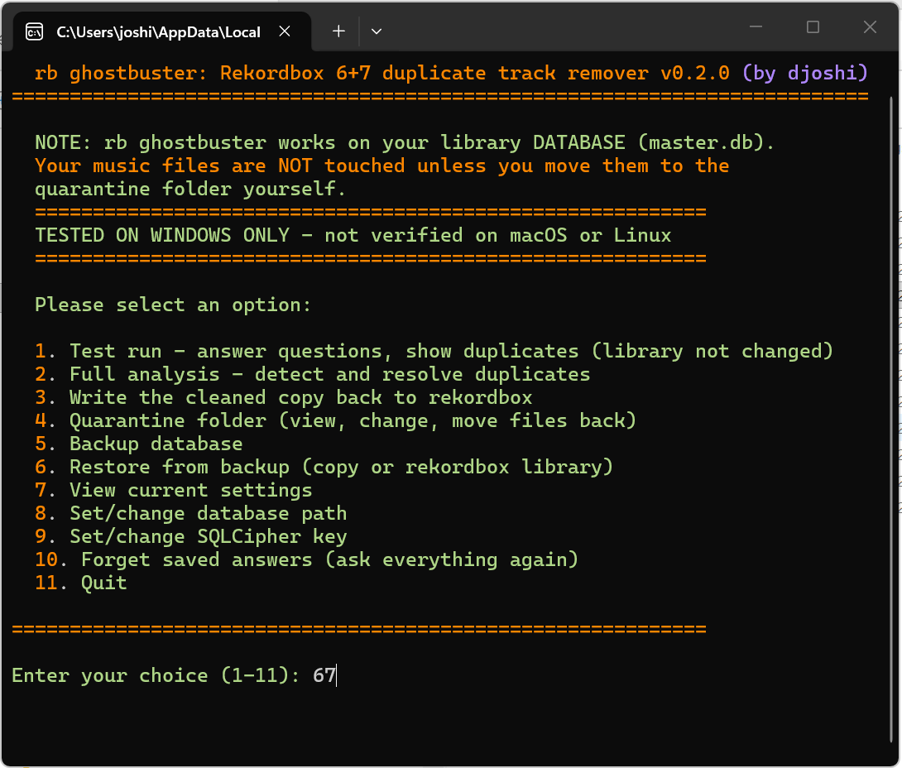

# rb ghostbuster v0.2.0 alpha

by **djoshi**

Finds duplicate tracks in your rekordbox 6/7 library and clears them out. Works on a copy, backs up first, and lets you undo changes.




Built on [pyrekordbox](https://github.com/dylanljones/pyrekordbox) by Dylan Jones and [sqlcipher3-wheels](https://pypi.org/project/sqlcipher3-wheels/) for opening the encrypted database.

**Download:** [rb-ghostbuster-main.zip](https://github.com/d-j-o-s-h-i/rb-ghostbuster/archive/refs/heads/main.zip) · Repo: https://github.com/d-j-o-s-h-i/rb-ghostbuster
> ⚠️ **Windows only atm.** Tested on Win11. It may work on macOS and Linux as its Python but nobody has tried it there yet. Lemme know if you can!

> ⚠️ **Close rekordbox first::** Quit rekordbox and rekordboxAgent before you start. The tool needs `master.db` so we're not getting inbetween a child custody fight like some of us

> ⚠️ **Turn off Cloud Library Sync** And any other sync to a second device, while you're cleaning. rb ghostbuster writes straight into `master.db`, so a sync running at the same time can put the tracks right back.

---

## What it does

Like most people, i am frustrated with rekordbox (and the company as a whole). In this case, specifically how it doesn't deal with duplicates at all (which can stack up over the years in your library) and how other tools on here don't really do their job, at least for me. This is how this little program was born:::

rb ghostbuster reads your library database, finds tracks that are really the actually the same song, and groups them up. In hard cases, you pick which copy stays. The rest drop out, and their playlist spots, tags and play history go to the copy you keep.

For example, "C:\Users\joshi\Music\0426\Just an Illusion.m4a" as well as "C:\Users\joshi\Download\just-an-illusion.mp3" exist simultaneously and you've put both of them in 5 different playlists. rb ghostbuster will find both, compare, and decide which version to keep and direct all 5 playlist paths to one version only. See 'How Duplicate Detection Works', down this doc.
Nothing gets deleted off your disk. Music files that only the removed entries used go into a `quarantine` folder, and you can move them back later. So far, my own rekordbox is 600 songs lighter 🌬️

One thing to know before you say yes: cue points don't come along. A removed copy takes its cues, beat grid and analysis data with it, and only the copy you keep keeps its own. That's why the tool suggests the one with the most cue points. If two copies have very different cues, look before you leap. I honestly don't think merging cue points is a useful feature.

None of this would read a rekordbox library without other people's work. The table and column names come from [pyrekordbox](https://github.com/dylanljones/pyrekordbox) by Dylan Jones, which documents the rekordbox 6/7 database. [sqlcipher3](https://github.com/coleifer/sqlcipher3) by Charles Leifer handles the encrypted SQLite part, and the prebuilt [sqlcipher3-wheels](https://pypi.org/project/sqlcipher3-wheels/) comes from laggykiller. That one installs itself on first run. Thx to yall <3.
Everything else, meaning the matching, the quarantine, the backups, the undo and this whole interface, is plain Python. 

Lemme know how we can integrate rb-ghostbuster into your tool =)

---

## Installation (noob-proof i hope)

All you need is Python. The one library it needs installs itself the first time you run it.

### Step 1: Get Python

**Windows:**
1. Go to [python.org/downloads](https://www.python.org/downloads/)
2. Grab the latest Python 3 installer
3. Tick **"Add Python to PATH"** on the first screen. Don't skip that one.
4. Hit Install Now

**macOS / Linux:**
Python is usually already there. You check it in Terminal, which is just a window where you type commands.

1. Open Terminal:
   - **macOS:** `Cmd + Space`, type `Terminal`, press Enter.
   - **Linux:** `Ctrl + Alt + T`, or find Terminal in your app menu.
2. Type this and press Enter:

   ```bash
   python3 --version
   ```

3. Read the answer:
   - Something like `Python 3.11.4` means you're good, go to Step 2.
   - `command not found` means install Python first, then try again.

### Step 2: Download it

1. Open **https://github.com/d-j-o-s-h-i/rb-ghostbuster**
2. Click the green **Code** button, then **Download ZIP**
3. Extract the ZIP somewhere you'll remember. On Windows, right-click it and pick **Extract All**.
4. Open the folder you just extracted

That's the whole download. No installer, no admin rights, nothing put anywhere else on your machine.

**Or grab the ZIP straight from here:**
https://github.com/d-j-o-s-h-i/rb-ghostbuster/archive/refs/heads/main.zip

<details>
<summary>Prefer git?</summary>

```bash
git clone https://github.com/d-j-o-s-h-i/rb-ghostbuster.git
cd rb-ghostbuster
```

To update a clone later, `git pull`. Your `master.db`, `settings.json`, `decisions.json`, `backups` and `quarantine` are all ignored by git, so pulling won't touch your library or your answers.

</details>

### Step 3: Run it

**Windows:** open the folder and double-click `rb ghostbuster.pyw`. A window opens on its own.

If nothing happens, click the address bar in that folder, type `cmd`, press Enter, then run:

```cmd
python "rb ghostbuster.pyw"
```

**macOS / Linux:**
1. Open Terminal.
2. Type `cd ` with a space after it, drag the rb ghostbuster folder into the window, press Enter.
3. Then run:

   ```bash
   python3 "rb ghostbuster.pyw"
   ```

   Leave that Terminal window open while it's running.

First run installs `sqlcipher3-wheels` for you. On Linux, and on Homebrew Python, the system sometimes blocks installs with an `externally-managed-environment` message. rb ghostbuster deals with that itself: it retries with a user-only override, and if that's still refused it makes a private `.venv` inside its own folder. Nothing goes system-wide.

Then you get a welcome screen that asks if rekordbox is closed, looks for your library in the usual place, offers to copy `master.db` into the folder, and drops you in the menu.

### Step 4: Use it

`master.db` lives next to the script. If the tool found your library on startup it offers to copy it there. If it didn't, menu option 8 lets you point at it.

Move the folder wherever you like. The database and settings travel with it.

---

## Menu Options

| # | Option | What it does |
|---|--------|--------------|
| 1 | Test run | Finds every duplicate group and shows you the list. It asks about the tracks it isn't sure of and keeps your answers for option 2, but it never writes to the library |
| 2 | Full analysis | Same detection, plus it asks which copy to keep in each unclear group, prints the whole plan, then applies it: duplicates out, playlists, tags and play history moved to the keeper |
| 3 | Write the cleaned copy back to rekordbox | Copies the cleaned library over the real `master.db`. You have to type `YES` first. This is the destructive one |
| 4 | Quarantine folder | Shows what's in quarantine, lets you change the folder, move leftover duplicate files in, or move them back out |
| 5 | Backup database | Makes a timestamped backup right now |
| 6 | Restore from backup | Puts an earlier backup back, either into the working copy or into the real library (that's the undo for option 3) |
| 7 | View current settings | Paths, backup folder, quarantine folder, key status, and whether the copy is current |
| 8 | Set/change database path | Point it at a different `master.db`, with the option to copy it into the folder first |
| 9 | Set/change SQLCipher key | For libraries that don't use the standard key |
| 10 | Forget saved answers | Moves `decisions.json` aside so it asks everything again, including the ones you said "no" to |
| 11 | Quit | Closes the program |

---

## How Duplicate Detection Works

1. Reads every track out of `master.db`
2. Cleans up the titles: lowercases them, strips accents and punctuation
3. Matches on the full title, or on the "core" title with remix and edit tags in brackets ignored
4. Compares artist, file path and length, with 3 seconds of wiggle room on the length
5. Groups whatever matches using union-find
6. Suggests a keeper and shows you the group

Which copy it suggests: A. one that still has its file, B. then the most cue points, C. then the one in more playlists, D. then the higher bitrate. If two are identical in every way, `Track (1).mp3` loses to `Track.mp3`, then E. the shorter path wins, then F. whichever you imported first.

Your answers go in `decisions.json`, so you won't be asked twice. Changed your mind? Option 10 forgets everything.

---

## Safety Features

| Feature | Description |
|---------|-------------|
| **Backup first** | A timestamped backup of `master.db` is made before anything changes |
| **Backup format** | One folder per backup, named day-month-year_time (e.g. `backups/26-10-2026_17-30-00/`), with `master.db` inside |
| **Backup cleanup** | The newest 10 are kept, and the newest 10 safety copies of your real library are counted separately, so normal backups can't push those out |
| **Safety backup** | Replacing the real library always backs it up first |
| **Atomic write-back** | The cleaned library goes to a temp file, gets checked, then swaps in. If it dies halfway you still have a working `master.db` |
| **Quarantine, not delete** | Files that only the removed copies used go to `quarantine/`, never deleted |
| **Undo** | Option 6 puts any backup back |
| **Test run** | Option 1 looks and asks, never writes |
| **Playlist integrity** | Playlist entries, tags and play history move to the keeper, positions are renumbered and checked for orphans before saving |
| **One window at a time** | A second copy refuses to start, so two windows can't edit the same library |

Cues, beat grids and analysis data of a **removed** copy go with it. Playlists, tags and history move to the keeper.

---

## File Structure

```
rb ghostbuster/
├── rb ghostbuster.pyw    # Main script (double-click to run on Windows)
├── README.md             # This file
├── LICENSE               # MIT license
├── .gitignore            # Keeps your library out of git
├── master.db             # Your rekordbox database copy (created on first run)
├── settings.json         # Your saved settings (created at runtime; contains your SQLCipher key)
├── .rbg.lock             # "one window at a time" lock (created at runtime)
├── decisions.json        # Your duplicate decisions (created at runtime)
├── duplicates_log.csv    # Log of actions taken
├── files_to_delete.txt   # Files marked for removal
├── quarantine_log.csv    # Which music file went where in quarantine
├── backups/              # Timestamped database backups (day-month-year-time format)
├── quarantine/           # Removed tracks go here (safe, not deleted)
├── screenshots/
│   └── menu.png          # The screenshot in this README
├── config/
│   └── settings.example.json  # Example settings file
└── .venv/                # Optional: private Python env, only created if a normal install is blocked
```

`settings.json` holds your key and your paths. Keep it to yourself.

---

## Troubleshooting

| Problem | Solution |
|---------|----------|
| `"python" is not recognized` | Install Python and tick "Add Python to PATH" |
| Database not found | Close rekordbox, then use menu option 8 to point at your `master.db` |
| Can't open database | rekordbox and rekordboxAgent both need to be closed |
| Could not read tracks | Not a rekordbox `master.db`, or your library uses a different SQLCipher key (menu option 9) |
| Double-click does nothing | Run it from a terminal instead: `python "rb ghostbuster.pyw"` |
| "already running in another window" | Close the other window. The lock clears when it exits |
| Asked about the same songs again | Option 10 restores the questions. Delete `decisions_old_*.json` if you want the old answers gone for good |

---

## License

MIT. Do what you like with it, see [LICENSE](LICENSE).

---

**Keep a backup anyway.** rb ghostbuster makes its own before every change, but an extra copy of your library has never hurt anyone.

```
    \|/                -----
   - * -           //...:|::..\\
    /|\           /.\::::|::::/.\
   ,---.         |.:::\::|:./:::.|
  / . . \        |:.::::\o/::.:::|
 |. . . .|       |:::.::/o\::::.:|
 | . . . |       |.:::/.:|::\:::.|
  \ . . /         \./::::|::::\./
   '---'           \\..::|:...//
                       -----

come back anytime =)
```
